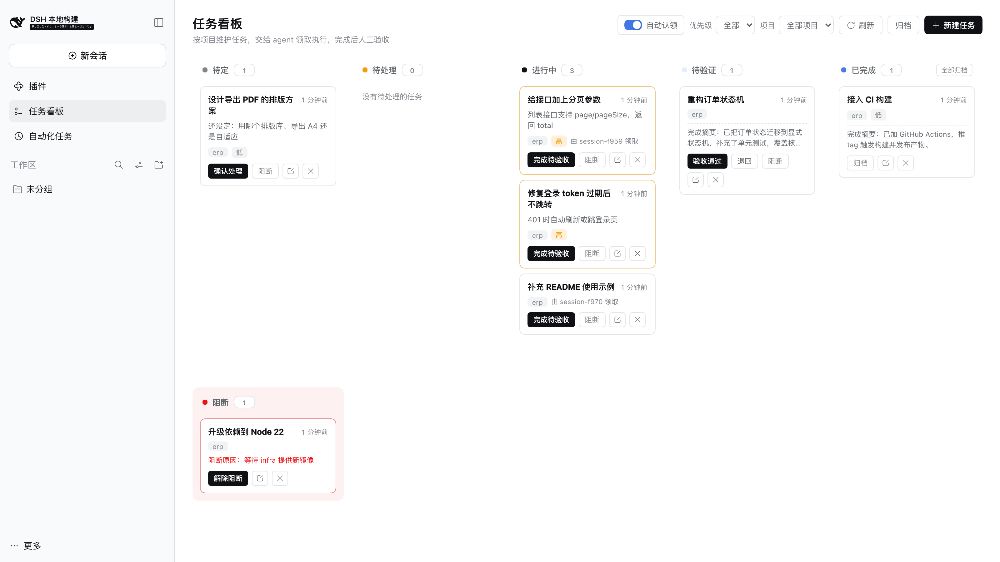

# dsh-project-tasks — a project task board for DSH

English | [中文](README.zh.md)

A [DSH (DeepSeek Harness)](https://github.com/deepseek-ai/deepseek-harness) bundle
plugin that adds a **Task board**: a three-column kanban (**Todo / In progress /
Done**) of tasks that **belong to a project (a workspace directory)**. You create
tasks on the board; an **agent pulls a project's pending tasks, executes them, and
marks them done** through `task_board_*` tools — a host-authoritative task ledger
the model and the board share.

- **Project-scoped**: every task is owned by a project path; the agent works "the
  tasks of the project it is running in" by default.
- **Agent round-trip**: `task_board_list` → `task_board_claim` → `task_board_complete`.
  A system-prompt section teaches the model the flow.
- **Host-authoritative, durable**: tasks persist in the Host (`storage-domain`); the
  board updates live over SSE as the agent works.
- **No setup**: install, and the board appears in the sidebar.

## Screenshot



## Install

```sh
dsh plugin --profile web add dsh-project-tasks
```

Restart `dsh web` (or reopen the GUI) and refresh the page: a **Task board** entry
appears in the sidebar. It is a **bundle** (`dsh.bundle`), so `dsh plugin add`
inserts its loader row automatically.

## Using it

- **Create a task**: header **New task** → pick a project (workspace), title,
  optional description, and priority (low / normal / high).
- **Move / delete**: each card has ← → to change status and a delete button
  (click twice to confirm).
- **Filter**: the project selector narrows the board to one project or all.
- **Let the agent do it**: in any session, say e.g. *"处理 erp 项目的待办任务"* — the
  agent calls `task_board_list` (a short project name like `erp` matches by suffix),
  `task_board_claim`s each task, does the work, then `task_board_complete`s it with a
  summary. The board reflects it live.

## Agent tools

| Tool | Purpose |
|---|---|
| `task_board_list({ project?, status? })` | List pending (todo + in_progress) tasks for a project. Omit `project` to use the current session working directory; a short name matches a known project by suffix. Returns id, status, priority, title, and full description. |
| `task_board_claim({ id })` | Claim a task (`todo → in_progress`), recording the calling session as owner. |
| `task_board_complete({ id, summary, files? })` | Finish a task (`→ done`) with a concise summary and optional touched files. |

Plus a system-prompt **section** that instructs the model how to pull and process a
project's tasks (process one at a time, prefer higher priority, never fabricate a
completion).

## How it works

- **Host half** (`src/index.ts`): owns the task domain (`storage-domain`, a
  `dsh_task_board` unit), registers the three tools + the prompt section, and
  registers `/taskboard` HTTP + SSE routes on `ctx.webServer`. Task ownership derives
  from the calling session's working directory.
- **Browser half** (`src/client/`): the kanban page. It reads/writes
  `/taskboard/api/*` same-origin and subscribes to `/taskboard/events` (SSE) for live
  updates.
- **Bundle patch** (`cordis.patch.yml`): inserts the plugin row; the node half runs in
  the host, the `dsh.client` half loads in the web GUI.

Data is stored on the host (not per-project files), so the board is consistent across
sessions and frontends.

## Develop / build

```sh
npm run link-deps   # link the DSH source checkout's packages into ./node_modules
npm run build       # tsc -> lib/types, tsdown -> lib/index.js (host) + lib/client.js (web)
```

Default checkout path is `../../../source/deepseek-harness`; override with
`DSH_CHECKOUT=/path/to/deepseek-harness`.

## Security note

DSH gates only `/api` with browser auth. Custom routes such as `/taskboard` are
trusted at the server boundary (as the built-in HMR events route is). The write
routes additionally refuse a cross-origin `Origin`. Run the GUI on loopback or behind
a trusted reverse proxy, as you would the rest of DSH.

## Contact

- Technical questions / bug reports: please open an [Issue](https://github.com/hyper-open/dsh-task-board/issues).
- Chat / collaboration: add me on WeChat (scan the QR, note "GitHub").

<p align="center"></p>

## License

[MIT](LICENSE)
