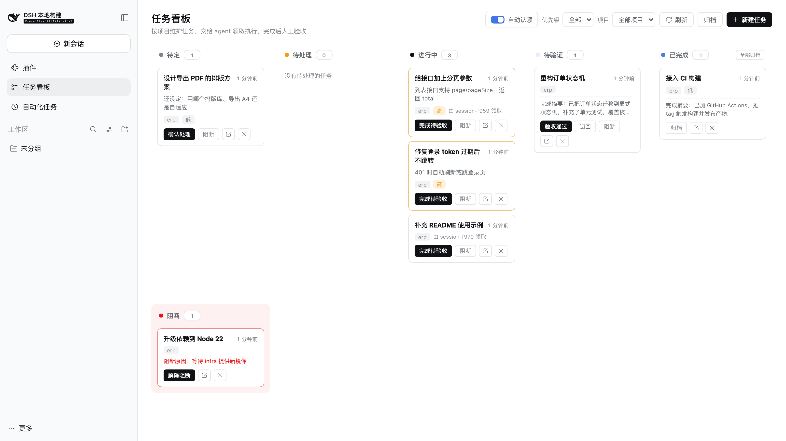

# dsh-project-tasks — DSH 项目任务看板

[English](README.md) | 中文

一个 [DSH（DeepSeek Harness）](https://github.com/deepseek-ai/deepseek-harness) 的
bundle 插件：增加一块 **任务看板**——多列看板，每个任务**归属一个项目（workspace 目录）**。
你在看板上建任务、管理任务；**agent 通过 `task_board_*` 工具拉取指定项目的待处理任务、
执行、并转入待验证**——一份 Host 权威的任务台账，模型与看板共享。

- **按项目归属**：每个任务属于一个项目路径；agent 默认处理"它所在项目的任务"。
- **完整生命周期**：`待定 → 待处理 → 进行中 → 待验证 → 已完成`，另有 `阻断` 侧态。
  人工对「待验证」验收通过（→ 已完成）或退回（→ 进行中）。
- **优先级**：低 / 中 / 高，按高→低排序，并支持优先级筛选。
- **agent 闭环**：`task_board_list` → `task_board_claim` → `task_board_complete`
  （→ 待验证），另有 `task_board_update` 处理其他移动。系统提示里附有使用指引。
- **自动派发**：可选的轮询把「待处理」任务领取并**真的派发一个 agent 会话来执行**。
- **归档**：已完成任务可归档（从看板隐藏，可恢复）；已完成列默认折叠，可展开。
- **Host 权威、持久**：任务存于 Host（`storage-domain`）；agent 干活时看板通过 SSE 实时刷新。
- **零配置**：装上即用，侧边栏出现「任务看板」。

## 截图



## 看板列

| 列 | 状态 | 含义 |
|---|---|---|
| 待定 | `draft` | 还没定稿。 |
| 待处理 | `ready` | 已确认可处理（agent 可领取）。 |
| 进行中 | `in_progress` | 正在做（某会话持有）。 |
| 待验证 | `review` | 做完了，等人工验收。 |
| 已完成 | `done` | 验收通过。 |
| 阻断 | `blocked` | 被依赖卡住；记住待恢复的状态。 |

## 安装

```sh
dsh plugin --profile web add dsh-project-tasks
```

重启 `dsh web`（或重开 GUI）并刷新页面，侧边栏出现 **任务看板** 入口。它是 **bundle**
（`dsh.bundle`），`dsh plugin add` 会自动插入 Loader 行。

## 使用

- **建任务**：顶部 **新建任务** → 选项目（工作区）、标题、可选描述、优先级（低/中/高）、
  可选「直接标记为待处理」，以及可选的 **复用空闲会话**（默认不勾：勾上后自动派发时，
  若同项目有空闲会话就在其继续，而不是新建）。
- **推进**：卡片按状态给不同动作——待定 → **确认处理**；待处理 → **▶ 开始**；进行中 →
  **完成待验收**；待验证 → **验收通过** / **退回**；任意 → **阻断** / **解除阻断**。
- **编辑 / 删除**：✏️ 按钮就地编辑标题、描述、优先级；× 按钮删除（点两次确认）。
- **优先级**：每列内按 高 → 中 → 低 排序；顶部有优先级筛选。
- **归档**：已完成卡有 **归档**；已完成列头有 **全部归档**；顶部 **归档** 开关进入归档视图
  （可恢复）。已完成列默认只显示最新 10 个，可展开。
- **筛选**：项目下拉把看板收窄到某项目或全部。
- **自动认领/派发**：顶部 **自动认领** 开关（默认开）会让后台把「待处理」任务领取，并在
  该项目工作区**派发一个真实 agent 会话**去执行，完成后转入「待验证」。
- **交给 agent**：在任意会话里说「处理 erp 项目的待办任务」——agent 调 `task_board_list`
  （短项目名 `erp` 会按后缀匹配）、逐条 `task_board_claim` 领取、完成后
  `task_board_complete` 写摘要。看板实时反映。

## Agent 工具

| 工具 | 作用 |
|---|---|
| `task_board_list({ project?, status? })` | 列某项目的 `ready` + `in_progress` 任务（默认 `pending`）。省略 `project` 用当前会话工作目录；短名按后缀匹配已知项目。返回 id、状态、优先级、标题、完整描述，高优先级在前。 |
| `task_board_claim({ id })` | 领取 `draft`/`ready` 任务（`→ 进行中`），记录调用会话为负责人。阻断/待验证中的任务不可领取。 |
| `task_board_complete({ id, summary, files? })` | 标记工作完成（`→ 待验证`），写简明摘要与（可选）改动文件。仍需人工验收。 |
| `task_board_update({ id, status, reason? })` | 其他移动：设为 `blocked`（可带原因）、从 `draft` 置 `ready`、置 `in_progress`（退回待验证）、或置 `done`（验收）。 |

外加系统提示 **section**，告诉模型如何拉取并处理某项目的任务（逐个处理、优先高优先级、
不得虚构完成）。

## 工作原理

- **Host 半边**（`src/index.ts`）：持有任务 domain（`storage-domain`，unit `dsh_task_board`），
  注册工具 + 提示 section，并在 `ctx.webServer` 上注册 `/taskboard` HTTP + SSE 路由。
  任务归属取自调用会话的工作目录。自动认领轮询会在任务所属工作区建会话并提示其执行任务。
- **浏览器半边**（`src/client/`）：看板页。同源读写 `/taskboard/api/*`，订阅
  `/taskboard/events`（SSE）实时更新。
- **bundle patch**（`cordis.patch.yml`）：插入插件行；node 半边在 host 跑，`dsh.client`
  半边在 Web GUI 加载。

数据存 Host（非项目内文件），因此跨会话、跨前端一致。

## 开发 / 构建

```sh
npm run link-deps   # 把 DSH 源码 checkout 的包软链进 ./node_modules
npm run build       # tsc -> lib/types，tsdown -> lib/index.js（host）+ lib/client.js（web）
```

默认 checkout 路径 `../../../source/deepseek-harness`，可用 `DSH_CHECKOUT=...` 覆盖。

## 安全说明

DSH 只对 `/api` 做浏览器鉴权；`/taskboard` 这类自定义路由在服务器边界处被信任（内置 HMR
事件路由亦然）。写路由额外拒绝跨源 `Origin`。请像对待 DSH 其余部分一样，让 GUI 跑在
loopback 或可信反向代理之后。

## 联系作者

- 技术问题 / Bug 反馈：请提 [Issue](https://github.com/hyper-open/dsh-task-board/issues)。
- 交流 / 合作：扫码添加微信（备注 GitHub）。

<p align="center"></p>

## 许可证

[MIT](LICENSE)
